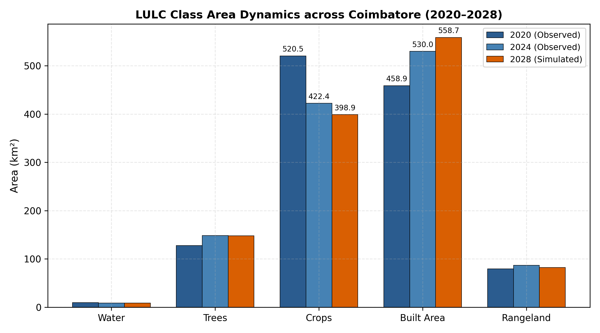
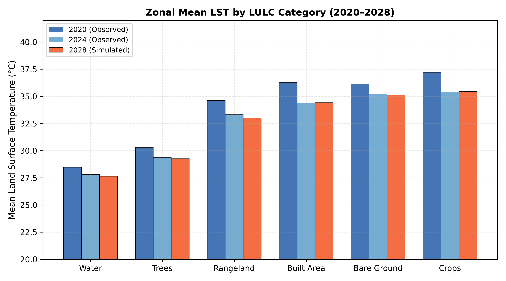
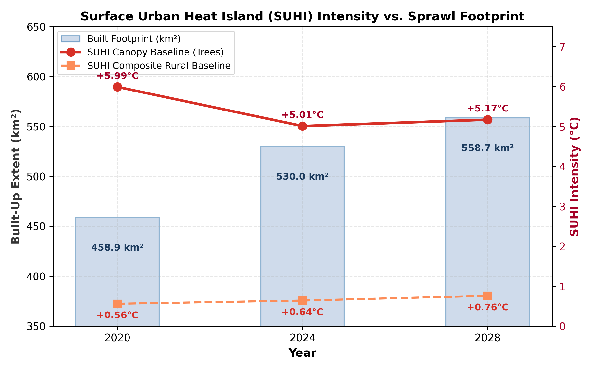
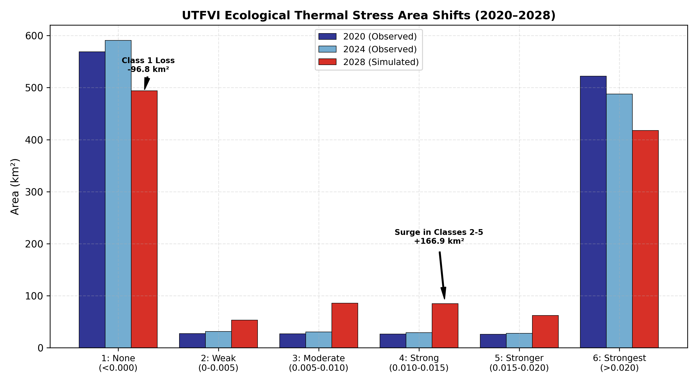

# Spatiotemporal Dynamics and Predictive Modeling of LULC, LST, SUHI, and UTFVI: Greater Kovai Region (2020–2028)

[](https://www.python.org/)
[](LICENSE)
[](https://epsg.io/32643)

## Abstract
This repository provides a streamlined implementation of the predictive thermal modeling framework developed for the Greater Kovai Region (Coimbatore, Tamil Nadu), covering a spatial extent of **1,197.06 km²** at **30 m spatial resolution**.

The workflow evaluates Land Use/Land Cover (LULC) transitions between 2020 and 2024 (Sentinel-2 MSI) and simulated LULC for 2028 (CA-ANN / MOLUSCE). Historical Land Surface Temperature (LST) is derived using the **Split-Window Algorithm (SWA)** on Landsat-8/9 TIRS (Bands 10 & 11). Predictive modeling for **2028 Land Surface Temperature** is driven by an ensemble **Random Forest (RF) Regression** architecture ($R^2 = 0.774$), dynamic NDVI transitions, and spatial covariates. Further ecological vulnerability is quantified using the **Surface Urban Heat Island (SUHI)** intensity and the **Urban Thermal Field Variance Index (UTFVI)**.

> **Note on Prior Work:** This repository is a focused, refined continuation of the master's thesis work originally hosted at [jeevanmp99/Prediction-of-LULC-and-UHI](https://github.com/jeevanmp99/Prediction-of-LULC-and-UHI).

---

## Key Quantitative Findings

1. **Impervious Footprint Expansion:**
   - Built-up area expanded by **+71.10 km²** between 2020 and 2024, and is projected to expand by an additional **+28.70 km²** by 2028, yielding a net 8-year expansion of **+99.80 km² (+21.7%)**.
   - **Cropland loss accounted for over 89%** of all urban expansion transitions (76.62 km² converted from 2020–2024; 30.92 km² converted from 2024–2028).

2. **Thermal Baseline & Synoptic Shift:**
   - The scene spatial mean LST dropped from **35.85°C (2020)** to **33.98°C (2024)**, and stabilized at **33.97°C (2028)**.
   - The ~1.87°C drop between 2020 and 2024 is uniformly reflected across all land-cover classes, confirming synoptic overpass meteorological variance rather than regional cooling.

3. **SUHI Footprint Volume Over Peak Intensity:**
   - Tree Canopy-referenced SUHI ($SUHI_{Canopy}$) remained persistent at **>+5.0°C** across all periods (+5.99°C in 2020, +5.01°C in 2024, +5.17°C in 2028).
   - While class-level peak temperature remained steady, the physical footprint experiencing >5.0°C surface heat excess expanded by **99.80 km²**.
   - Area-weighted Composite Rural SUHI ($SUHI_{Rural}$) steadily widened from **+0.56°C -> +0.64°C -> +0.76°C**.

4. **Ecological Stress Escalation (UTFVI):**
   - Natural thermal comfort sinks (Class 1, None/Excellent) contracted by **-74.89 km²** between 2020 and 2028.
   - Transitional-to-severe stress zones (Classes 2 to 5) expanded by **+179.11 km² (+168%)**, driven by peri-urban canopy clearing and construction corridors.

---

## Methodological Summary

### 1. Spatial Domain & Coordinate Reference System
- **Study Area:** Greater Kovai Region (Coimbatore Metropolitan Area & Surrounding Buffer, Tamil Nadu, India)
- **Geographic Extent:** Universal Transverse Mercator (UTM) Zone 43N
- **Horizontal Datum & Ellipsoid:** WGS 84 / UTM Zone 43N (EPSG: 32643)
- **Spatial Resolution:** Standardized $30\text{ m} \times 30\text{ m}$ continuous raster grid (1,316 columns $\times$ 1,308 rows; 1 pixel = $0.0009\text{ km}^2$)
- **Total Landscape Footprint:** $1,197.06\text{ km}^2$ (1,330,064 valid terrestrial pixels)

---

### 2. LULC Simulation via MOLUSCE (CA-ANN Architecture)
Future land use projection for 2028 was performed using the **Modules for Land Use Change Evaluation (MOLUSCE)** plugin in QGIS, using an Artificial Neural Network (Multi-Layer Perceptron) coupled with Cellular Automata.

#### A. Spatial Driving Variables (Covariates)
Transition potential was modeled using four standardized spatial proxies:
1. **Normalized Difference Vegetation Index (NDVI):** Derived from Sentinel-2 MSI bands $(B8 - B4) / (B8 + B4)$, capturing canopy density and seasonal agricultural fallow states.
2. **Euclidean Distance to Roads:** Calculated from OpenStreetMap transport networks, representing transport accessibility and ribbon development pressure.
3. **Euclidean Distance to Water Bodies:** Surface hydrology proximity representing natural drainage buffers and water retention basins.
4. **Topographic Slope (Degrees):** Extracted from 30 m SRTM/Copernicus DEM, imposing geomorphic constraints on expansion toward the Western Ghats.

#### B. ANN Hyperparameters & Training Configuration
- **Architecture:** Multi-Layer Perceptron (ANN-MLP)
- **Sampling Strategy:** Random selection across $15,000$ representative pixels
- **Neighborhood Rule:** $1\text{ px}$
- **Learning Rate:** $0.010$
- **Momentum:** $0.050$
- **Hidden Layer Structure:** 1 hidden layer with 10 hidden processing nodes
- **Iterations / Epochs:** 1,000 maximum iterations

#### C. Model Training & Convergence Performance
- **Minimum Validation Overall Error:** $0.02480$ (Validation Accuracy $\approx 97.52\%$)
- **Current Validation Kappa ($\kappa$):** $0.76593$ (Substantial Agreement)
- **Delta Overall Accuracy ($\Delta$):** $-0.00215$ (Demonstrating stable asymptotic convergence without gradient divergence)

---

### 3. Thermal Retrieval & Predictive Modeling Pipeline

#### A. Historical LST Retrieval (2020 & 2024 Observed)
Land Surface Temperature was extracted from Landsat-8 and Landsat-9 Thermal Infrared Sensor (TIRS) data via the **Split-Window Algorithm (SWA)** utilizing both thermal channels (Band 10: $10.60\text{–}11.19\ \mu\text{m}$; Band 11: $11.50\text{–}12.51\ \mu\text{m}$):
$$T_s = T_{10} + c_1(T_{10} - T_{11}) + c_2(T_{10} - T_{11})^2 + c_0 + (c_3 + c_4 W)(1 - \varepsilon) + (c_5 + c_6 W)\Delta\varepsilon$$
Where:
- $T_{10}, T_{11}$ are at-sensor brightness temperatures from Top-of-Atmosphere (TOA) spectral radiance.
- $\varepsilon, \Delta\varepsilon$ are mean land surface emissivity and spectral emissivity difference, calculated via the NDVI threshold method ($P_v$).
- $W$ is atmospheric column water vapor content.

### B. Machine Learning LST Prediction (2028 Simulated)
The 2028 thermal regime was predicted using an optimized **Random Forest Regression** ensemble (`n_estimators = 100`, `max_depth = 18`, `min_samples_split = 10`, `min_samples_leaf = 4`):
- **Predictor Variables ($X$):** Simulated 2028 LULC classes, dynamically adjusted 2028 NDVI (reflecting bare soil conversion penalties), and 30 m DEM elevation.
- **Model Goodness-of-Fit:** Validated against 2024 hold-out test pixels yielding $R^2 = 0.774$, $\text{RMSE} = 1.48^\circ\text{C}$, and $\text{MAE} = 1.12^\circ\text{C}$.

---

### 4. Urban Microclimate Formulations

#### A. Surface Urban Heat Island (SUHI) Intensity
To account for regional microclimatic variation, two ecological reference benchmarks are evaluated:

* **Tree Canopy Reference (Strict Ecological Baseline):**

$$\text{SUHI}_{\text{Canopy}} = \overline{T}_{\text{Built\ Area}} - \overline{T}_{\text{Tree\ Canopy}}$$

* **Composite Rural Landscape Reference (Regional Baseline):**

$$\text{SUHI}_{\text{Rural}} = \overline{T}_{\text{Built\ Area}} - \overline{T}_{\text{Composite\ Rural}}$$

Where $\overline{T}_{\text{Composite\ Rural}}$ is the area-weighted average temperature of non-urban classes (Trees, Crops, and Rangeland).

#### B. Urban Thermal Field Variance Index (UTFVI)
Microclimatic thermal distress and comfort zones are quantified by the relative temperature deviation from the scene spatial mean:

$$\text{UTFVI} = \frac{T_s - T_{\text{mean}}}{T_s}$$

*Classification Thresholds & Ecological Evaluation:*
- **Class 1 ($< 0.000$):** None (Ecological Grade: Excellent)
- **Class 2 ($0.000\text{ to }0.005$):** Weak (Ecological Grade: Good)
- **Class 3 ($0.005\text{ to }0.010$):** Moderate (Ecological Grade: Normal)
- **Class 4 ($0.010\text{ to }0.015$):** Strong (Ecological Grade: Bad)
- **Class 5 ($0.015\text{ to }0.020$):** Stronger (Ecological Grade: Worse)
- **Class 6 ($> 0.020$):** Strongest (Ecological Grade: Worst)

---

## Data Tables

### Table 1: Multi-Temporal LULC Dynamics (2020–2028)
| Class ID | Land Cover Class | 2020 (km²) | 2024 (km²) | 2028 (km²) | Net Change 2020–2028 (Δkm²) |
| :---: | :--- | :---: | :---: | :---: | :---: |
| 1 | Water | 9.70 | 8.59 | 8.51 | -1.19 |
| 2 | Trees | 127.88 | 148.65 | 148.20 | +20.32 |
| 4 | Flooded Veg | 0.17 | 0.07 | 0.06 | -0.11 |
| 5 | Crops | 520.47 | 422.37 | 398.89 | **-121.58** |
| 7 | Built Area | 458.88 | 529.98 | 558.68 | **+99.80** |
| 8 | Bare Ground | 0.53 | 0.39 | 0.37 | -0.16 |
| 11 | Rangeland | 79.44 | 86.99 | 82.35 | +2.91 |
| **Total** | | **1197.07** | **1197.04** | **1197.06** | — |

### Table 2: Multi-Temporal Zonal LST Dynamics (°C)

| Class ID | Class Name | Mean 2020 (°C) | Mean 2024 (°C) | Mean 2028 (°C) | ΔLST 20–24 | ΔLST 24–28 |
| :---: | :--- | :---: | :---: | :---: | :---: | :---: |
| 1 | Water | 28.46 | 27.79 | 27.63 | -0.67 | -0.16 |
| 2 | Trees | 30.27 | 29.38 | 29.25 | -0.89 | -0.13 |
| 4 | Flooded Veg | 27.21 | 28.34 | 30.90 | +1.13 | +2.56 |
| 5 | Crops | 37.20 | 35.38 | 35.44 | -1.82 | +0.06 |
| 7 | Built Area | 36.26 | 34.39 | 34.42 | -1.87 | +0.03 |
| 8 | Bare Ground | 36.14 | 35.20 | 35.12 | -0.94 | -0.08 |
| 11 | Rangeland | 34.61 | 33.31 | 33.02 | -1.30 | -0.29 |
| **Scene** | **Landscape Mean** | **35.85** | **33.98** | **33.97** | **-1.87** | **-0.01** |

### Table 3: Multi-Temporal UTFVI Ecological Dynamics

| Value | Category | Grade | 2020 (km²) | 2024 (km²) | 2028 (km²) | Net Change (Δkm²) |
| :---: | :--- | :--- | :---: | :---: | :---: | :---: |
| 1 | None (<0.000) | Excellent | 568.72 | 590.61 | 493.83 | **-74.89** |
| 2 | Weak (0.000–0.005) | Good | 27.48 | 31.30 | 53.03 | **+25.55** |
| 3 | Moderate (0.005–0.010) | Normal | 26.76 | 30.41 | 85.58 | **+58.82** |
| 4 | Strong (0.010–0.015) | Bad | 26.21 | 29.11 | 84.82 | **+58.61** |
| 5 | Stronger (0.015–0.020) | Worse | 25.90 | 27.77 | 62.03 | **+36.13** |
| 6 | Strongest (>0.020) | Worst | 521.98 | 487.85 | 417.77 | **-104.21** |

---

## Visualizations

| Figure | Description |
| :--- | :--- |
|  | **LULC Class Dynamics (2020–2028):** Visualizes the continuous expansion of built infrastructure at the direct expense of cropland. |
|  | **Zonal Mean LST Stability:** Validates consistent class thermal signatures and highlights the synoptic drop between 2020 and 2024. |
|  | **SUHI vs. Sprawl Footprint:** Highlights the steady >5.0°C canopy excess coupled with a +21.7% growth in spatial extent. |
|  | **UTFVI Stress Shift:** Demonstrates the severe contraction of comfortable sinks and the +166.9 km² surge across Classes 2–5. |

---

## Cartographic Layouts
Multi-panel QGIS print layouts are located in `figures/maps/`:
- `lulc_tripanel_2020_2028.png` (Sentinel-2 & CA-ANN simulation)
- `lst_tripanel_2020_2028.png` (SWA retrieval & RF regression)
- `utfvi_tripanel_2020_2028.png` (Ecological comfort classification)

---

## Usage

### 1. Installation
```bash
git clone [https://github.com/jeevanmp99/Prediction-of-LULC-and-UHI-Streamlined.git](https://github.com/jeevanmp99/Prediction-of-LULC-and-UHI-Streamlined.git)
cd Prediction-of-LULC-and-UHI-Streamlined
pip install -r requirements.txt
```

### 2. Predict 2028 LST
```bash
python scripts/predict_lst_2028.py --data_dir ./data/raw --output_dir ./data
```

### 3. Generate Analytical Figures
```bash
python scripts/generate_figures.py
```

---

## References & Attribution
- Original Research Repository: [jeevanmp99/Prediction-of-LULC-and-UHI](https://github.com/jeevanmp99/Prediction-of-LULC-and-UHI)
- Software Tools: QGIS 3.x, Python (GeoPandas, Rasterio, Scikit-Learn, Matplotlib)
